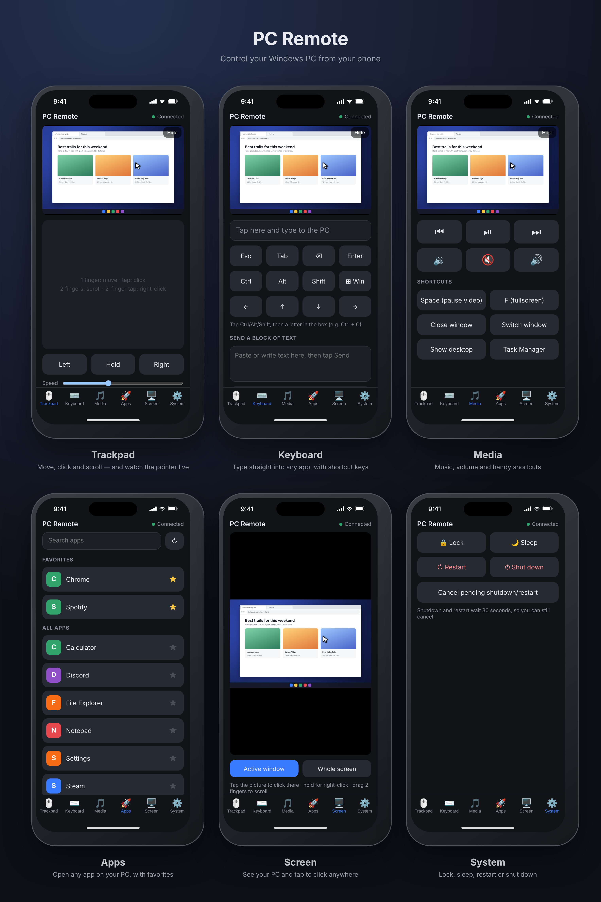

# PC Remote

Control your Windows PC from your phone: trackpad, keyboard, media keys, open apps, see your screen, and sleep or shut down. It works on iPhone and Android, including Samsung Galaxy phones, foldables and tablets with Samsung Internet or Chrome, and you don't need an App Store app.

<p align="center">
  
</p>

## Features

- **Trackpad:** move, tap to click, two-finger scroll, right-click, drag.
- **Keyboard:** type straight into the PC, plus Ctrl/Alt/Shift shortcuts and arrow keys.
- **Media:** play/pause, next/previous track, volume, and handy shortcuts.
- **Apps:** every app in your Start menu, with search and favorites. Tap one to open it on the PC.
- **Screen:** a live view of the active window or the whole screen. Tap the picture to click there.
- **System:** lock, sleep, restart and shut down. Restart and shut down wait 30 seconds so you can cancel.
- **One file:** it uses only Python's standard library, so there's nothing else to install.

## Setup

1. Install Python 3 on your Windows PC from [python.org/downloads](https://www.python.org/downloads/).
2. Download [`server.py`](server.py) (click it, then the download button) and put it somewhere it can stay.
3. Double-click `server.py`. If Windows Firewall asks, click **Allow**.
4. The window shows a link like `http://192.168.1.20:8765/?k=abcd2345ef`. Open it in the browser on your phone. The phone must be on the **same Wi-Fi**.
5. Add it to your Home Screen:
   - **iPhone:** Share → **Add to Home Screen**
   - **Android (Chrome):** ⋮ menu → **Add to Home screen**
   - **Samsung Internet:** ≡ menu → **Add page to** → **Home screen**

**Start with Windows (optional):** right-click `server.py` → **Create shortcut**. Press `Win + R`, type `shell:startup` and move the shortcut into that folder.

## Troubleshooting

| Problem | Fix |
|---|---|
| **Wrong key** | Type the link exactly as the window shows it. Make sure only one copy of `server.py` is running. |
| **PC not reachable / site can't be reached** | Make sure the phone is on the same Wi-Fi (not mobile data or a guest network). Allow Python through Windows Firewall, or run this in an admin terminal: `netsh advfirewall firewall add rule name="PC Remote" dir=in action=allow protocol=TCP localport=8765`. Some routers block devices from talking to each other ("AP/client isolation"); turn that off in the router settings. |
| **Smart App Control blocks a file** | Double-click `server.py` directly. It runs with Python, which Windows trusts. |
| **Screen is black** | Some full-screen games can't be captured this way. |
| **Link opens inside Discord / another app and fails** | Open Chrome or Samsung Internet yourself and type the link in, starting with `http://`. |
| **Samsung: page won't load** | Turn off **Secure Wi-Fi** or any VPN on the phone (Settings → Connections), and make sure the phone isn't set to switch to mobile data. |

## Security

- The link contains a random key, and the PC ignores requests without it. The key is saved in `config.json` next to `server.py`. Delete that file to make a new one.
- Traffic is **not encrypted**, so use it on your home Wi-Fi only. **Do not** forward the port on your router to the internet. To use it away from home, install [Tailscale](https://tailscale.com) on the PC and the phone, and use the PC's Tailscale address in the link.

## Turning the PC on from your phone

PC Remote can't turn on a PC that's off, because nothing is running on it yet. Use **Wake-on-LAN** instead, with a free app like Wolow (iPhone) or Wake On Lan (Android). Your PC needs an Ethernet cable, "Wake on Magic Packet" enabled for the network adapter in Device Manager, Fast Startup turned off, and Wake-on-LAN / "Power On By PCI-E" enabled in the BIOS.

## For developers

`server.py` in the main folder is built from the readable source in [`source/`](source/):

```bash
python source/build_single.py
```

On non-Windows systems the server runs in **dry-run** mode. It logs commands instead of sending input, which is handy for working on the phone UI.

## License

[MIT](LICENSE)
